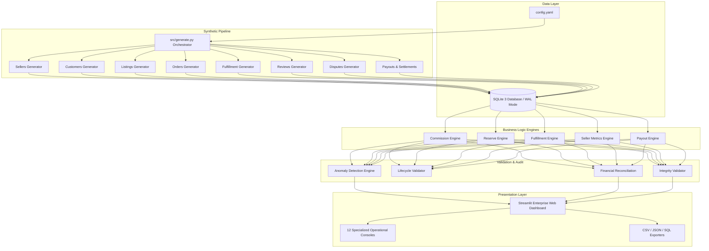

# System Architecture Documentation
**SellerOps Intelligence Platform**  
*Enterprise Multi-Sided Marketplace Operations, SLA Monitoring & Financial Reconciliation Engine*

---

## 1. High-Level Architectural Overview

The SellerOps Intelligence Platform is architected as an enterprise-grade operational intelligence and financial reconciliation platform designed for multi-sided marketplaces. The system monitors seller service-level agreements (SLAs), fulfillment performance, customer dispute claims, category commissions, rolling reserves, and payout eligibility.

---

## 2. Core Architectural Pillars

### 2.1 Deterministic High-Performance Data Generation
- Utilizes seeded pseudorandom number generators (`seed=42`) ensuring bit-for-bit reproducibility across runs.
- High-throughput batch ingestion using SQLite Write-Ahead Logging (WAL) and multi-row parameterized transactions (`executemany`), processing **100,000 orders and 10,000 disputes in under 7 seconds**.
- Ground-truth separation: All 5 injected operational exceptions are registered in an isolated table `anomalies_ground_truth` with permanent unique identifiers (`ANO-x-xxxx`).

### 2.2 Financial Precision Engine
- Fixed two-decimal currency precision using Python `Decimal` and SQL `ROUND(..., 2)` to eliminate floating-point drift.
- Full double-entry balance enforcement:
  $$\text{Gross Amount} = \text{Commission Amount} + \text{Reserve Amount} + \text{Net Seller Amount}$$
- Header-to-line reconciliation tracking:
  $$\text{Net Payout Amount} = \sum_{i=1}^{n} \text{Net Line Amount}_i$$

### 2.3 Finite State Machine (FSM) Lifecycle Modeling
The platform strictly models temporal causality:
1. **Order Flow:** `PLACED` $\rightarrow$ `CONFIRMED` $\rightarrow$ `SHIPPED` $\rightarrow$ `DELIVERED` (or `CANCELLED` / `RETURNED`).
2. **Fulfillment SLA:** Dispatched within 48 hours = `ON_TIME`; dispatched after 48 hours = `LATE`.
3. **Dispute Lifecycle:** `OPEN` $\rightarrow$ `UNDER_REVIEW` $\rightarrow$ `RESOLVED_BUYER_FAVOR` / `RESOLVED_SELLER_FAVOR` / `CHARGEBACK_LOST`.
4. **Reserve & Payout:** Delivery confirmed $\rightarrow$ Hold window elapses ($7$ to $30$ days) $\rightarrow$ Reserve released $\rightarrow$ Batch disbursement.

### 2.4 Enterprise White Design System
- Built on Streamlit with an enforced light enterprise design language:
  - Pure white `#FFFFFF` background.
  - Charcoal `#111827` primary typography.
  - Slate `#64748B` metadata text.
  - Border `#E2E8F0` with subtle elevation drop-shadows.
  - Crisp Plotly charts adhering to restrained blue, green, orange, and red palettes.
