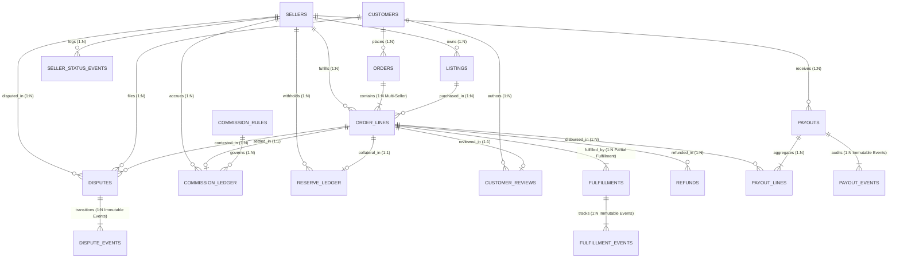

# Relational Database Schema Architecture v2.0
**SellerOps Intelligence Platform**

---

## 1. Entity-Relationship Overview & Cardinalities

---

## 2. Core Architectural Capabilities

### 2.1 Multi-Seller Orders
A single consumer purchase (`Order`, e.g. `ORD-2026-000001`) contains multiple items across different merchants (`OrderLine`, e.g. `ORDLN-2026-000001-01` and `ORDLN-2026-000001-02`). Each order line maintains its own `seller_id`, unit price, gross amount, commission ledger, and independent lifecycle status.

### 2.2 Partial Fulfillment
A single order line for 10 units may be fulfilled in batches from separate fulfillment centers:
- `FUL-ORDLN-2026-000001-01-01`: 6 units shipped via FedEx.
- `FUL-ORDLN-2026-000001-01-02`: 4 units shipped via UPS.
Each fulfillment maintains distinct tracking numbers, dispatch dates, SLA statuses, and immutable `fulfillment_events` logs.

### 2.3 Immutable Lifecycle History (Event Sourcing)
Historical events are append-only and never overwritten:
- `seller_status_events`: Tracks merchant status transitions (`ACTIVE` $\rightarrow$ `PROBATION` $\rightarrow$ `SUSPENDED`).
- `fulfillment_events`: Logistics milestones (`LABEL_CREATED`, `PICKED_UP`, `IN_TRANSIT`, `OUT_FOR_DELIVERY`, `DELIVERED`).
- `dispute_events`: Dispute adjudication audit trail (`BUYER`, `SELLER`, `ARBITRATOR`, `SYSTEM`).
- `payout_events`: Banking gateway disbursement attempts and webhooks.

### 2.4 Absolute Financial Precision (Integer Paise / Minor Units)
All currency values are stored as 64-bit signed integers (`*_cents INTEGER NOT NULL`), eliminating IEEE 754 floating-point drift:
- ₹10.50 is stored as `1050` paise.
- Rate basis points: 1 basis point = 0.01% (e.g. 800 basis points = 8.00%).
- Full double-entry balance check:
  $$\text{Gross Paise} = \text{Commission Paise} + \text{Reserve Paise} + \text{Net Seller Paise}$$

---

## 3. Canonical ID Conventions

| Entity | Canonical Pattern | Example |
| :--- | :--- | :--- |
| **Seller** | `^SELL-\d{6}$` | `SELL-000001` |
| **Listing** | `^LIST-SELL-\d{6}-\d{6}$` | `LIST-SELL-000001-000001` |
| **Order** | `^ORD-\d{4}-\d{6}$` | `ORD-2026-000001` |
| **Order Line** | `^ORDLN-\d{4}-\d{6}-\d{2}$` | `ORDLN-2026-000001-01` |
| **Fulfillment** | `^FUL-ORDLN-\d{4}-\d{6}-\d{2}(-\d{2})?$` | `FUL-ORDLN-2026-000001-01` |
| **Dispute** | `^DSP-\d{4}-\d{6}$` | `DSP-2026-000001` |
| **Payout** | `^PAYOUT-\d{4}-\d{6}$` | `PAYOUT-2026-000001` |
| **Payout Line** | `^PLN-PAYOUT-\d{4}-\d{6}-\d{2}$` | `PLN-PAYOUT-2026-000001-01` |
| **Customer** | `^CUST-\d{6}$` | `CUST-000001` |
| **Review** | `^REV-\d{4}-\d{6}$` | `REV-2026-000001` |
| **Commission Rule** | `^CR-\d{6}$` | `CR-000001` |
