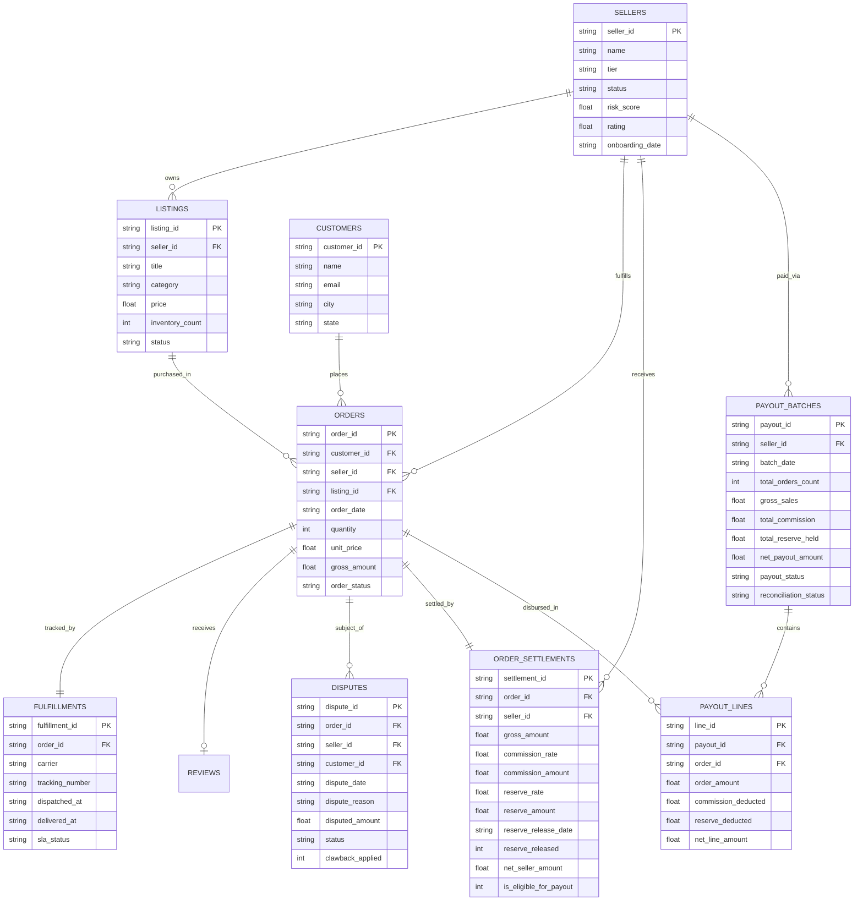

# Relational Schema Specification
**SellerOps Intelligence Platform**

---

## 1. Entity Relationship Overview

---

## 2. Table Definitions & Constraints

### 2.1 `sellers`
- **Primary Key:** `seller_id` (`SLR-xxxxx`)
- **Constraints:**
  - `tier IN ('STANDARD', 'PREFERRED', 'ENTERPRISE', 'PROBATION', 'SUSPENDED')`
  - `status IN ('ACTIVE', 'PROBATION', 'SUSPENDED', 'UNDER_REVIEW')`
  - `risk_score BETWEEN 0.0 AND 100.0`
  - `rating BETWEEN 1.0 AND 5.0`

### 2.2 `customers`
- **Primary Key:** `customer_id` (`CST-xxxxx`)
- **Attributes:** `name`, `email`, `city`, `state`, `country`, `created_at`

### 2.3 `listings`
- **Primary Key:** `listing_id` (`LST-xxxxxx`)
- **Foreign Key:** `seller_id REFERENCES sellers(seller_id)`
- **Constraints:** `price > 0.0`, `inventory_count >= 0`, `status IN ('ACTIVE', 'OUT_OF_STOCK', 'SUSPENDED', 'ARCHIVED')`

### 2.4 `orders`
- **Primary Key:** `order_id` (`ORD-xxxxxx`)
- **Foreign Keys:**
  - `customer_id REFERENCES customers(customer_id)`
  - `seller_id REFERENCES sellers(seller_id)`
  - `listing_id REFERENCES listings(listing_id)`
- **Constraints:** `quantity > 0`, `gross_amount > 0.0`, `order_status IN ('PLACED', 'CONFIRMED', 'SHIPPED', 'DELIVERED', 'CANCELLED', 'RETURNED')`

### 2.5 `fulfillments`
- **Primary Key:** `fulfillment_id` (`FLF-xxxxxx`)
- **Foreign Key:** `order_id UNIQUE REFERENCES orders(order_id)`
- **Constraints:** `sla_status IN ('ON_TIME', 'LATE', 'CANCELLED', 'IN_TRANSIT')`

### 2.6 `reviews`
- **Primary Key:** `review_id` (`REV-xxxxxx`)
- **Foreign Key:** `order_id UNIQUE REFERENCES orders(order_id)`
- **Constraints:** `rating BETWEEN 1 AND 5`

### 2.7 `disputes`
- **Primary Key:** `dispute_id` (`DSP-xxxxxx`)
- **Foreign Keys:** `order_id`, `seller_id`, `customer_id`
- **Constraints:** `disputed_amount > 0.0`, `status IN ('OPEN', 'UNDER_REVIEW', 'RESOLVED_BUYER_FAVOR', 'RESOLVED_SELLER_FAVOR', 'CHARGEBACK_LOST')`, `clawback_applied IN (0, 1)`

### 2.8 `order_settlements`
- **Primary Key:** `settlement_id`
- **Foreign Keys:** `order_id UNIQUE`, `seller_id`
- **Financial Balance:** `gross_amount = commission_amount + reserve_amount + net_seller_amount`

### 2.9 `payout_batches`
- **Primary Key:** `payout_id` (`PO-xxxxxx`)
- **Foreign Key:** `seller_id`
- **Constraints:** `payout_status IN ('SCHEDULED', 'PROCESSING', 'PAID', 'HELD', 'FAILED')`, `reconciliation_status IN ('MATCHED', 'DISCREPANCY', 'PENDING')`

### 2.10 `payout_lines`
- **Primary Key:** `line_id`
- **Foreign Keys:** `payout_id REFERENCES payout_batches(payout_id)`, `order_id REFERENCES orders(order_id)`
- **Balance:** `net_line_amount = order_amount - commission_deducted - reserve_deducted - dispute_deducted`

### 2.11 `anomalies_ground_truth`
- **Primary Key:** `anomaly_id` (`ANO-x-xxxx`)
- **Attributes:** `anomaly_type`, `entity_type`, `entity_id`, `description`, `severity`, `detected`, `created_at`
